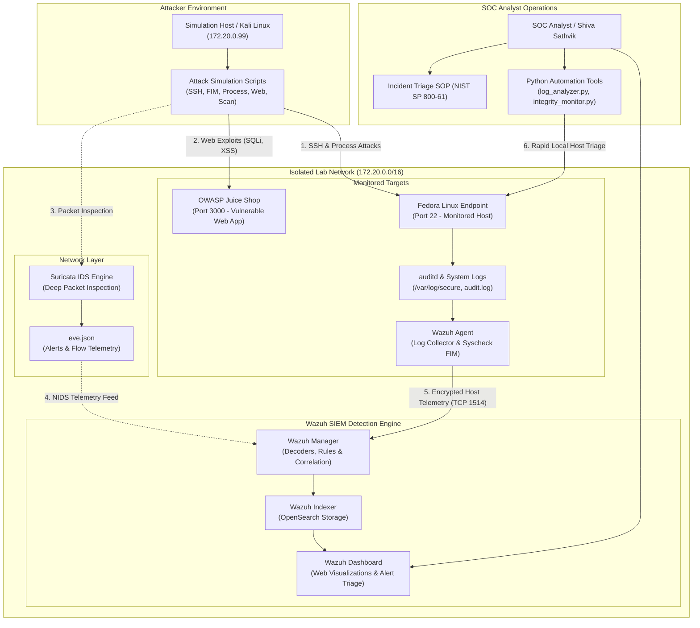

<div align="center">

# Cybersecurity Homelab – SOC Monitoring, Threat Detection & Incident Response

A hands-on, portfolio-ready defensive security homelab demonstrating multi-layer telemetry collection, real-time threat detection, SIEM correlation, and automated incident triage using free and open-source tools.

[](#project-status)
[](https://github.com/shivasathvik44/cybersecurity-homelab)
[](LICENSE)
[](https://codespaces.new/shivasathvik44/cybersecurity-homelab)

<p align="center">
  
  
  
  
  
  
  
  
</p>

</div>

---

## Table of Contents
- [1. Introduction](#1-introduction)
- [2. Quick Start: Free Online Lab in GitHub Codespaces](#2-quick-start-free-online-lab-in-github-codespaces)
- [3. Architecture](#3-architecture)
- [4. Technology Stack & Environment Comparison](#4-technology-stack--environment-comparison)
- [5. Lab Features](#5-lab-features)
- [6. Security Attack Scenarios](#6-security-attack-scenarios)
- [7. Hands-On FIM Experiment & Evidence](#7-hands-on-fim-experiment--evidence)
- [8. Hands-On SSH Brute-Force & Log Analysis Experiment](#8-hands-on-ssh-brute-force--log-analysis-experiment)
- [9. Installation & Setup Guide (Local VM / Dedicated Host)](#9-installation--setup-guide-local-vm--dedicated-host)
- [10. Security Automation Scripts](#10-security-automation-scripts)
- [11. Lab Evidence & Forensic Artifacts](#11-lab-evidence--forensic-artifacts)
- [12. Learning Outcomes](#12-learning-outcomes)
- [13. Future Improvements](#13-future-improvements)
- [14. Author](#14-author)

---

## 1. Introduction

### What is a Cybersecurity Homelab?
A cybersecurity homelab is a controlled, isolated sandbox environment that replicates real-world enterprise infrastructure. It allows defensive engineers and security analysts to deploy services, simulate realistic cyber threats, capture telemetry across network and host layers, and validate detection rules without endangering production systems.

### Why I Built This Project
As an aspiring Cybersecurity and SOC Analyst, I built this repository to bridge the gap between abstract theoretical knowledge and hands-on operational defense. While theory teaches security principles, enterprise defense requires working directly with Linux audit logs, understanding SIEM rule hierarchies, parsing packet captures, and responding systematically to attacks under industry frameworks such as NIST SP 800-61.

### Security Problems Demonstrated
This homelab directly addresses common attack surfaces and SOC challenges:
- **Visibility Gaps**: Capturing kernel-level command execution that standard application logging misses.
- **Credential Stuffing & Brute Force**: Distinguishing between isolated user typos and automated dictionary attacks.
- **Unauthorized Data & Configuration Tampering**: Real-time detection of altered critical files and privilege files (`/etc/passwd`, `/etc/sudoers`).
- **Web Exploitation Blindspots**: Inspecting Layer 7 application transactions for injection strings (SQLi, XSS, Path Traversal).
- **Network Reconnaissance**: Identifying host discovery sweeps before active exploitation commences.

### Learning Goals
1. Master SIEM configuration, decoder mechanics, and correlation logic within **Wazuh**.
2. Instrument Linux hosts with **auditd** for deep syscall visibility.
3. Configure **Suricata NIDS** for signature-based packet inspection.
4. Develop custom **Python** and **Bash** automation tools for rapid triage and file integrity checking.
5. Practice structured incident documentation following **NIST SP 800-61 Rev. 2** guidelines.

---

## 2. Quick Start: Free Online Lab in GitHub Codespaces

You can run, test, and experiment with this entire defensive laboratory **100% free online in your web browser** using **GitHub Codespaces**. No VirtualBox, VMware, or cloud server subscription is needed.

### 5-Step Setup Guide

1. **Open Repository on GitHub**:
   Navigate to [https://github.com/shivasathvik44/cybersecurity-homelab](https://github.com/shivasathvik44/cybersecurity-homelab) (or your fork).

2. **Launch Codespaces**:
   Click the green **`<> Code`** button -> Select the **`Codespaces`** tab -> Click **`Create codespace on main`**.

   [](https://codespaces.new/shivasathvik44/cybersecurity-homelab)

3. **Automatic Provisioning**:
   VS Code will launch directly in your browser. Codespaces automatically runs `.devcontainer/setup.sh`, which installs Python packages (`pytest`, `ruff`, `pyyaml`), sets script permissions, and validates your environment in under 60 seconds.

4. **Open Terminal**:
   Press **`Ctrl + \``** (or **`Cmd + \``** on macOS) or navigate to `≡` -> `Terminal` -> `New Terminal`.

5. **Run the Demonstration Experiments**:
   ```bash
   # Experiment 1: SSH Brute-Force & Authentication Log Analysis
   bash scenarios/01-ssh-bruteforce/run_demo.sh

   # Experiment 2: File Integrity Monitoring (FIM)
   bash scenarios/02-file-integrity/run_demo.sh
   ```

To run all automated unit tests:
```bash
python3 -m unittest discover -s tests -v
```

> [!TIP]
> For the complete beginner walkthrough and manual step-by-step commands, see the [Online Lab Guide](docs/ONLINE_LAB_GUIDE.md) and [Experiment Documentation](docs/experiments/01-ssh-bruteforce.md).

---

## 3. Architecture

The homelab architecture models an enterprise detection and incident response pipeline. Attack traffic originates in a separated simulation zone, crosses an isolated bridge network, targets protected endpoints and applications, generates multi-layer telemetry, and surfaces as correlated alerts in the SOC dashboard.



### Telemetry & Investigation Relationship
1. **Attack Simulation**: Controlled, non-destructive scripts generate targeted adversary activity.
2. **Endpoint Telemetry**: Linux kernel syscalls (`execve`), authentication records, and file modification events are captured.
3. **Network Monitoring**: Suricata passively parses network frames and logs Layer 7 application payloads.
4. **SIEM Correlation**: Wazuh normalizes diverse event streams, compares them against rule thresholds, and maps alerts to MITRE ATT&CK techniques.
5. **Security Investigation**: The analyst triages alerts, utilizes custom Python automation for rapid root-cause isolation, and executes formal incident response runbooks.

---

## 4. Technology Stack & Environment Comparison

### Component Breakdown
| Technology | Role in Homelab | Implementation Status | Notes |
|---|---|---|---|
| **Fedora Linux** | Primary Monitored Endpoint | **Implemented** | Hosts target services, auditd, and local telemetry collectors |
| **Wazuh SIEM** | Central Log Management, FIM & Correlation | **Configured (Template Ready)** | Docker Compose configuration & custom rules ready; pending full local indexing setup (TODO) |
| **Docker / Podman** | Container Runtime & Subnet Isolation | **Implemented** | Provides isolated `172.20.0.0/16` bridge network with safety boundaries |
| **OWASP Juice Shop** | Vulnerable Web Application Target | **Implemented** | Deployed via container; bound strictly to `127.0.0.1:3000` |
| **Suricata** | Network Intrusion Detection System (NIDS) | **Configured (Template Ready)** | Engine config (`suricata.yaml`) and local signatures authored; deployment marked TODO |
| **Linux auditd** | Kernel-Level Syscall Auditing | **Implemented** | Custom `audit.rules` tracking process executions (`execve`) and privilege escalations |
| **Python 3** | Security Automation & Triage Scripts | **Implemented** | `log_analyzer.py` and `integrity_monitor.py` with 100% test coverage |
| **Bash** | System Health & Attack Simulation | **Implemented** | Safe, bounded simulation scripts with strict loopback/RFC 1918 enforcement |
| **Nmap** | Network Reconnaissance & Port Scanning | **Implemented (Optional)** | Used in Scenario 05 with bash TCP fallback support |
| **Burp Suite CE** | Web Application Proxy & Payload Testing | **Planned (Optional)** | Used for manual parameter tampering during web security scenarios |
| **Kali Linux** | Attacker Simulation Environment | **Planned (Optional)** | Alternative guest VM platform for external multi-tool simulation |

### Codespaces (Online Free) vs. Dedicated VM Comparison
To maintain rigorous technical transparency, the table below delineates what executes cleanly inside GitHub Codespaces versus what requires a dedicated Linux VM or bare-metal host:

| Capability | GitHub Codespaces (Free Online) | Dedicated VM / Bare-Metal Linux | Technical Rationale |
|---|:---:|:---:|---|
| **Python Security Scripts** (`log_analyzer.py`, `integrity_monitor.py`) | **YES** | **YES** | Operates entirely in user-space with standard Python 3 libraries. |
| **File Integrity Monitoring (FIM)** | **YES** | **YES** | Cryptographic SHA-256 baseline hashing requires no root or kernel privileges. |
| **Authentication Log Analysis** | **YES** | **YES** | Offline forensic parsing of auth logs operates on local or sample log files. |
| **OWASP Juice Shop Web App** | **YES** | **YES** | Single-container web applications run cleanly on Codespaces unprivileged Docker. |
| **Unit Testing & CI/CD** (`pytest`, `ruff`) | **YES** | **YES** | 100% automated test pass rate in Codespaces and GitHub Actions runners. |
| **Linux `auditd` Syscall Auditing** | **NO** | **YES** | Codespaces unprivileged containers drop `CAP_AUDIT_CONTROL`. Syscall netlink sockets require host kernel access. |
| **Suricata Promiscuous Sniffing** | **NO** | **YES** | Capturing foreign interface packets requires `CAP_NET_ADMIN` and `CAP_NET_RAW`. |
| **Full Wazuh Indexer Cluster** | **NO** | **YES** | OpenSearch indexer requires `vm.max_map_count=262144` and 4–6 GB dedicated RAM, causing OOM kills on 2-core instances. |

---

## 5. Lab Features

- **Centralized Log Monitoring**: Normalized ingestion of system authentication logs, kernel audit traces, and NIDS event logs.
- **Linux Endpoint Telemetry**: In-depth process execution tracking (`execve`), user privilege escalation (`sudoers`), and shell invocations.
- **Authentication Monitoring**: Automatic tracking and alerting of failed logins, dictionary attacks, and root login abuse.
- **File Integrity Monitoring (FIM)**: Cryptographic SHA-256 baseline tracking to detect unauthorized modification or creation of critical files.
- **Network Intrusion Detection (NIDS)**: Signature matching for port scans, SYN sweeps, and HTTP application attack vectors.
- **Web Application Security Testing**: Reproducible test cases against OWASP Top 10 vulnerabilities (SQLi, XSS, Path Traversal).
- **Incident Response Runbooks**: Structured SOPs and formal report templates based on NIST SP 800-61 Rev. 2.
- **Python Security Automation**: Standalone tools for rapid log analysis and offline cryptographic baseline verification.

---

## 6. Security Attack Scenarios

> [!NOTE]
> All simulations are designed with strict safety boundaries and are bounded to localhost (`127.0.0.1`) or the private lab subnet (`172.20.0.0/16`). Scenarios describe expected telemetry based on detection engineering rules; live captures are added during active lab testing.

```text
+--------------------------------------------------------------------------------+
|                        FIVE CORE DETECTION SCENARIOS                           |
+--------------------------------------------------------------------------------+
|  01. SSH Brute-Force        --> Threshold rate detection & source IP triage    |
|  02. File Integrity (FIM)   --> SHA-256 cryptographic modification detection   |
|  03. Suspicious Process     --> /tmp script execution & auditd syscall tracing |
|  04. Web Attacks (Juice)    --> SQLi, XSS & directory traversal inspection     |
|  05. Network Port Scanning  --> TCP SYN sweep heuristics & Suricata alerting   |
+--------------------------------------------------------------------------------+
```

### Scenario 01: SSH Brute-Force Detection
- **Objective**: Simulate repeated SSH authentication failures to test SIEM frequency correlation rules.
- **Tools**: `scenarios/01-ssh-bruteforce/simulation.sh`, OpenSSH daemon, `log_analyzer.py`.
- **Simulation**: Transmits bounded password attempts against port 22 with non-existent usernames.
- **Expected Telemetry**: `Failed password for invalid user ... from <IP>` in `/var/log/secure`.
- **Detection Method**: Wazuh Rule `5710` (single failure) and custom Rule `100001` (>=6 failures within 120s).
- **Investigation**: Execute `python3 scripts/log_analyzer.py --file /var/log/secure --threshold 5`.
- **Remediation**: Enforce SSH key-based authentication, disable root login, and apply Wazuh Active Response or Fail2ban IP drops.
- **Detailed Docs**: [Scenario 01 Guide](scenarios/01-ssh-bruteforce/README.md) | [Expected Results](scenarios/01-ssh-bruteforce/expected-results.md)

### Scenario 02: File Integrity Monitoring (FIM)
- **Objective**: Detect unauthorized file creation, modification, and deletion in a critical directory.
- **Tools**: `scenarios/02-file-integrity/simulation.sh`, Wazuh Syscheck, `integrity_monitor.py`.
- **Simulation**: Modifies `app.conf`, creates `unauthorized_script.sh`, and deletes `security_policy.json` inside `/tmp/homelab-fim-test/`.
- **Expected Telemetry**: Cryptographic hash change notifications, inode metadata updates, and `auditd` file write alerts.
- **Detection Method**: Wazuh Rules `550` (Modified), `554` (Added), `553` (Deleted) and `integrity_monitor.py --check`.
- **Investigation**: Inspect SHA-256 diffs and identify modifying PID with `sudo ausearch -f <file> -i`.
- **Remediation**: Restore altered files from version control or backup; apply immutable attribute (`chattr +i`).
- **Detailed Docs**: [Scenario 02 Guide](scenarios/02-file-integrity/README.md) | [Expected Results](scenarios/02-file-integrity/expected-results.md)

### Scenario 03: Suspicious Process Investigation
- **Objective**: Detect process execution from world-writable directories and obfuscated command lines.
- **Tools**: `scenarios/03-suspicious-process/simulation.sh`, Linux Auditd, `ausearch`.
- **Simulation**: Executes a script dropped into `/tmp`, runs a base64-encoded command wrapper, and simulates a mock egress port probe.
- **Expected Telemetry**: `SYSCALL` (syscall 59 `execve`) and `EXECVE` records with key `process_exec` in `/var/log/audit/audit.log`.
- **Detection Method**: Auditd filtering and Wazuh custom rule `100010`.
- **Investigation**: Reconstruct process tree with `ps -ef --forest` and inspect arguments with `ausearch -k process_exec -ts recent`.
- **Remediation**: Terminate suspicious process trees (`kill -9 <PID>`) and mount `/tmp` with `noexec` in `/etc/fstab`.
- **Detailed Docs**: [Scenario 03 Guide](scenarios/03-suspicious-process/README.md) | [Expected Results](scenarios/03-suspicious-process/expected-results.md)

### Scenario 04: Web Application Attack Detection
- **Objective**: Detect application-layer exploitation attempts targeting OWASP Juice Shop.
- **Tools**: `curl`, Burp Suite CE, Suricata NIDS.
- **Simulation**: Sends SQL injection (`UNION SELECT`), Reflected XSS, and Path Traversal payloads via HTTP GET/POST.
- **Expected Telemetry**: HTTP access logs and raw HTTP stream inspection in Suricata `eve.json`.
- **Detection Method**: Suricata Rules `1000002` (SQLi) and `1000003` (Path Traversal).
- **Investigation**: Review HTTP query parameters, status codes, and user-agent strings.
- **Remediation**: Implement prepared statements, input validation, and Web Application Firewall (WAF) filtering.
- **Detailed Docs**: [Scenario 04 Guide](scenarios/04-web-attacks/README.md) | [Test Cases](scenarios/04-web-attacks/test-cases.md)

### Scenario 05: Network Scanning Detection
- **Objective**: Identify network service discovery, port enumeration, and host sweeps.
- **Tools**: `scenarios/05-network-scanning/simulation.sh`, Nmap, Suricata NIDS.
- **Simulation**: Initiates rapid TCP SYN sweeps across ports 20–100 against target address.
- **Expected Telemetry**: Bursts of half-open TCP connections with SYN flag set.
- **Detection Method**: Suricata Rule `1000001` (`Potential Nmap Scripting Engine or SYN Sweep`).
- **Investigation**: Check connection rate using `ss -s` and inspect `eve.json` alert metadata.
- **Remediation**: Implement firewall rate limiting (`iptables -m hashlimit`) and block non-essential exposed ports.
- **Detailed Docs**: [Scenario 05 Guide](scenarios/05-network-scanning/README.md) | [Expected Results](scenarios/05-network-scanning/expected-results.md)

---

## 7. Hands-On FIM Experiment & Evidence

The repository includes a ready-to-run, online-friendly File Integrity Monitoring experiment designed to run in unprivileged container environments (like GitHub Codespaces) without root privileges or VM setups.

### Running the Demonstration

In your Codespaces terminal, run:

```bash
bash scenarios/02-file-integrity/run_demo.sh
```

### What this Demonstration Verifies

The experiment systematically executes and verifies 9 core defensive capabilities:
1. **Isolated Sandbox Initialization**: Creates `.fim_demo_lab` with configuration, security policy, and helper scripts.
2. **SHA-256 Cryptographic Baseline**: Hashes all files and records an immutable baseline snapshot in JSON.
3. **Clean Verification**: Detects 0 anomalies on unchanged files, returning exit code `0`.
4. **Content Modification Detection**: Detects parameter injection in `config.ini`, revealing hash divergence.
5. **Payload Creation Detection**: Flags the injection of an untrusted executable (`backdoor.sh`).
6. **Policy Deletion Detection**: Flags missing critical files (`policy.json`).
7. **Permission Error Resilience**: Safely handles unreadable/inaccessible files (`chmod 000`) without crashing.
8. **Corrupted Baseline Exception Handling**: Catches malformed JSON baselines and reports clean error messages.
9. **Forensic JSON Export**: Serializes the findings to `evidence/alert-exports/fim_demo_report.json`.

### Actual Terminal Output Evidence

```text
================================================================================
CYBERSECURITY HOMELAB - FILE INTEGRITY MONITOR REPORT
================================================================================
Monitored Directory : .../.fim_demo_lab
Baseline File       : .../.fim_demo_baseline.json
Status              : ⚠️  TAMPERING DETECTED
--------------------------------------------------------------------------------
Created Files       : 1
Modified Files      : 1
Deleted Files       : 1
Unchanged Files     : 1
Inaccessible Files  : 1
================================================================================

[+] NEW / CREATED FILES:
    + backdoor.sh (SHA-256: 2e3d25e589b74ddb...)

[!] MODIFIED FILES:
    ! config.ini
        Expected: aa2c0bd12d680ce2c9bd319475e1cc0f0893e7ff675bf9edbcaf36d20f07d170
        Current : d3cbe753a3da523ffce4df07434393a5bc495266656fa4d02233ca2f130a2c4c

[-] DELETED FILES:
    - policy.json (Expected SHA-256: 1aae3db7a77002d5...)

[?] INACCESSIBLE / SKIPPED FILES:
    ? locked_secret.key (Read error / permission denied)
================================================================================
```

### Forensic JSON Report Preview (`evidence/alert-exports/fim_demo_report.json`)

```json
{
  "has_anomalies": true,
  "created": [
    {
      "path": "backdoor.sh",
      "sha256": "2e3d25e589b74ddb7c9693609717ef785e685a0115d4fe6b53f8dca80d8d3225",
      "size_bytes": 93,
      "modified_time_iso": "2026-11-14T16:56:45+00:00"
    }
  ],
  "modified": [
    {
      "file": {
        "path": "config.ini",
        "sha256": "d3cbe753a3da523ffce4df07434393a5bc495266656fa4d02233ca2f130a2c4c",
        "size_bytes": 139,
        "modified_time_iso": "2026-11-14T16:56:45+00:00"
      },
      "expected_sha256": "aa2c0bd12d680ce2c9bd319475e1cc0f0893e7ff675bf9edbcaf36d20f07d170"
    }
  ],
  "deleted": [
    {
      "path": "policy.json",
      "sha256": "1aae3db7a77002d51a81261247fccadbbedda06d56e9a87d1df797d0c525e3a5"
    }
  ],
  "unchanged_count": 1,
  "inaccessible_files": [
    "locked_secret.key"
  ]
}
```

> [!NOTE]
> Document your own test runs using the [Experiment Log Template](docs/EXPERIMENT_LOG.md).

---

## 8. Hands-On SSH Brute-Force & Log Analysis Experiment

The repository includes a complete offline defensive authentication log analysis suite designed to run in unprivileged container environments (like GitHub Codespaces) without root privileges, virtual machines, or live network traffic.

### Running the Demonstration

In your Codespaces terminal, run:

```bash
bash scenarios/01-ssh-bruteforce/run_demo.sh
```

### What this Demonstration Verifies

The experiment systematically executes and verifies 7 core defensive capabilities:
1. **OpenSSH & PAM Log Parsing**: Extracts authentication attempts, source IPs, usernames, ports, and authentication methods.
2. **High-Volume Brute-Force Detection**: Flags IPs exceeding volumetric thresholds (e.g. `198.51.100.10` with 12 failures targeting `admin` and `root`).
3. **Horizontal Password Spraying Detection**: Catches attacks targeting multiple distinct usernames from a single source (`203.0.113.45` targeting 6 accounts: `operator`, `support`, `backup`, `deploy`, `testuser`, `manager`).
4. **Independent Critical Compromise Warning (`SUCCESS_AFTER_FAILURES`)**: Flags successful logins that were preceded by repeated failures (`198.51.100.77`), alerting analysts to potentially cracked credentials independently of volumetric limits.
5. **Threshold Tuning Trade-Offs**: Compares detection results across thresholds of **3**, **5**, and **10** failed attempts, illustrating false-positive vs. false-negative dynamics.
6. **Structured Forensic JSON Export**: Generates SIEM-ready structured JSON alert reports to `evidence/alert-exports/ssh_bruteforce_report.json`.
7. **Defensive Safety & Offline Isolation**: Operates with 0 root requirements and never modifies production system logs.

### Sensitivity & Threshold Tuning Analysis

| Metric | Threshold = 3 (Aggressive) | Threshold = 5 (Balanced) | Threshold = 10 (Strict Volume) |
|---|---|---|---|
| **Total Flagged IPs** | **4** (`198.51.100.10`, `203.0.113.45`, `198.51.100.77`, `192.0.2.80`) | **3** (`198.51.100.10`, `203.0.113.45`, `198.51.100.77`) | **3** (`198.51.100.10`, `203.0.113.45`, `198.51.100.77`) |
| **`198.51.100.10` (12 fails)** | ✅ `SSH_BRUTE_FORCE` | ✅ `SSH_BRUTE_FORCE` | ✅ `SSH_BRUTE_FORCE` |
| **`203.0.113.45` (6 user spray)** | ✅ `SSH_BRUTE_FORCE`, `PASSWORD_SPRAYING` | ✅ `SSH_BRUTE_FORCE`, `PASSWORD_SPRAYING` | ✅ `PASSWORD_SPRAYING` (Volume < 10, Spray Caught) |
| **`198.51.100.77` (Compromise)** | ✅ `SSH_BRUTE_FORCE`, `SUCCESS_AFTER_FAILURES` | ✅ `SSH_BRUTE_FORCE`, `SUCCESS_AFTER_FAILURES` | ✅ `SUCCESS_AFTER_FAILURES` (Volume < 10, Compromise Caught!) |
| **`192.0.2.80` (4 failures)** | ✅ `SSH_BRUTE_FORCE` | ❌ Suppressed (Noise filtered) | ❌ Suppressed (Noise filtered) |
| **Operational Impact** | Higher false-positive noise on minor user typos. | Optimal balance for small-to-midsize fleets. | Strict volumetric filtering; decoupled heuristics catch spray and compromise without blindspots. |

### Terminal Output Evidence

```text
====================================================================================
CYBERSECURITY HOMELAB - AUTHENTICATION LOG ANALYSIS REPORT
====================================================================================
Log Source Path       : scenarios/01-ssh-bruteforce/sample_auth.log
Threshold Filter      : >= 5 failed attempts
Spray Threshold       : >= 3 distinct targeted usernames
Compromise Threshold  : >= 2 failed attempts followed by login
Total Lines Processed : 47
Total Failed Logins   : 30
Suspicious IPs Flagged: 3
Compromise Warnings   : 1 (Successful login after repeated failures)
Spray Campaigns Found : 1
------------------------------------------------------------------------------------
Source IP          Failures   Success   First Seen       Detections
------------------------------------------------------------------------------------
198.51.100.10      12         0         Nov 16 09:00:01  SSH_BRUTE_FORCE
203.0.113.45       6          0         Nov 16 09:15:00  SSH_BRUTE_FORCE, PASSWORD_SPRAYING
198.51.100.77      5          1         Nov 16 10:20:01  SSH_BRUTE_FORCE, SUCCESS_AFTER_FAILURES
------------------------------------------------------------------------------------
DETECTION DETAILS & TARGETED ACCOUNTS:

[*] Source IP: 198.51.100.77
    - Failures : 5 | Successes: 1
    - Targeted Accounts : ubuntu (5)
    - Authenticated As  : ubuntu (1)
    - [DETECTED] Failed attempts (5) reached brute-force threshold (5)
    - [CRITICAL COMPROMISE] CRITICAL: Successful login for account(s) [ubuntu] following 5 failed attempts (repeated failure threshold: 2)
====================================================================================
```

### Forensic JSON Report Preview (`evidence/alert-exports/ssh_bruteforce_report.json`)

```json
{
  "metadata": {
    "log_file": "scenarios/01-ssh-bruteforce/sample_auth.log",
    "threshold": 5,
    "spray_threshold": 3,
    "repeat_failure_threshold": 2,
    "total_lines_processed": 47,
    "total_failures_detected": 30,
    "total_successes_detected": 1,
    "suspicious_ip_count": 3,
    "compromise_warnings_count": 1,
    "password_spray_count": 1
  },
  "suspicious_ips": [
    {
      "source_ip": "198.51.100.77",
      "total_failures": 5,
      "targeted_users": {
        "ubuntu": 5
      },
      "first_seen": "Nov 16 10:20:01",
      "last_seen": "Nov 16 10:20:13",
      "total_successes": 1,
      "successful_users": {
        "ubuntu": 1
      },
      "success_after_failure": true,
      "password_spray": false,
      "detections": [
        "SSH_BRUTE_FORCE",
        "SUCCESS_AFTER_FAILURES"
      ],
      "detection_reasons": [
        "Failed attempts (5) reached brute-force threshold (5)",
        "CRITICAL: Successful login for account(s) [ubuntu] following 5 failed attempts (repeated failure threshold: 2)"
      ]
    }
  ]
}
```

> [!TIP]
> For the complete technical writeup, regular expressions, and remediation playbooks, see [docs/experiments/01-ssh-bruteforce.md](docs/experiments/01-ssh-bruteforce.md).

---

## 9. Installation & Setup Guide (Local VM / Dedicated Host)

### 1. Prerequisites
- Linux Host (Fedora 38+, RHEL 9+, Ubuntu 22.04 LTS).
- Python 3.10+ installed.
- Docker Engine & Docker Compose V2 (or Podman) installed and running.
- Minimum 8 GB system RAM (16 GB recommended for full Wazuh Indexer stack).

### 2. Repository Setup
```bash
# Clone the repository
git clone https://github.com/shivasathvik44/cybersecurity-homelab.git
cd cybersecurity-homelab

# Initialize environment configuration
cp .env.example .env
```

### 3. Container Setup
Launch the OWASP Juice Shop target on the isolated bridge network:
```bash
# Start Juice Shop in background
docker compose up -d juice-shop

# Verify service is running
curl -I http://127.0.0.1:3000
```

### 4. Wazuh SIEM Setup
> [!NOTE]
> Wazuh single-node manager configuration is prepared in `docker-compose.yml` and `deployment/wazuh/`.
> - **TODO**: Set `vm.max_map_count=262144` on host: `sudo sysctl -w vm.max_map_count=262144`.
> - **TODO**: Deploy full Wazuh manager and indexer container profile: `docker compose --profile wazuh up -d`.

### 5. Endpoint Configuration
Instrument the host with Linux auditing and baseline rules:
```bash
# Install audit rules
sudo cp deployment/endpoint/audit/audit.rules /etc/audit/rules.d/homelab.rules
sudo augenrules --load
sudo auditctl -l
```

### 6. Test Environment Setup
Ensure simulation scripts are executable:
```bash
chmod +x scripts/*.py scripts/*.sh scenarios/*/*.sh
```

### 7. Validation
Run pre-flight checks and automated unit tests:
```bash
# Run environment health check
bash scripts/health_check.sh

# Run Python unit tests (pytest / unittest compatible)
python3 -m unittest discover -s tests -v
```

---

## 10. Security Automation Scripts

### 1. Authentication Log Analyzer (`scripts/log_analyzer.py`)
- Analyzes `/var/log/secure` and `/var/log/auth.log` formats.
- Aggregates failed login attempts by source IP and identifies targeted usernames.
- Configurable threshold filtering and structured JSON export.
- Safe, non-destructive, and handles missing or malformed log lines gracefully.

```bash
# Run analysis on standard secure log
python3 scripts/log_analyzer.py --file /var/log/secure --threshold 5
```

### 2. File Integrity Monitor (`scripts/integrity_monitor.py`)
- Computes SHA-256 cryptographic hashes for directory file trees.
- Establishes baseline snapshots in structured JSON.
- Compares directory state against baseline to detect created, modified, and deleted files.
- Resilient against unreadable files and broken symlinks; outputs human-readable tables or JSON.

```bash
# Step 1: Create baseline
python3 scripts/integrity_monitor.py --dir /tmp/homelab-fim-test --init --baseline /tmp/baseline.json

# Step 2: Compare against baseline
python3 scripts/integrity_monitor.py --dir /tmp/homelab-fim-test --check --baseline /tmp/baseline.json
```

### 3. Environment Health Check (`scripts/health_check.sh`)
- Validates essential command-line tools (`python3`, `git`, `curl`, container runtimes).
- Assesses container engine daemon status.
- Evaluates available system memory and disk utilization.
- Tests connectivity to local homelab service ports (`3000`, `1514`, `55000`, `443`).

```bash
bash scripts/health_check.sh
```

---

## 11. Lab Evidence & Forensic Artifacts

This repository maintains dedicated evidence directories for live exercise data:

```text
evidence/
├── screenshots/      # Placeholders for Wazuh dashboard & terminal captures
├── sample-logs/      # Sanitized raw authentication & audit log samples
└── alert-exports/    # Exported JSON alert records from Wazuh & Suricata
```

> [!NOTE]
> In accordance with strict portfolio integrity standards, this repository **never generates fake screenshots or fabricated alert outputs**. Screenshots and alert exports are populated during live simulation execution runs.

---

## 12. Learning Outcomes

Through the design and construction of this homelab, the following skills were developed:

- **SIEM Operations**: Configuring Wazuh decoders, rule hierarchies, parent-child rule relationships, and alert severity thresholds.
- **Linux Security & Telemetry**: Configuring `auditd` rules for process execution monitoring and analyzing PAM authentication logging subsystems.
- **Detection Engineering**: Developing hypothesis-driven detection rules and mapping adversary techniques to the MITRE ATT&CK framework.
- **Network Security Monitoring**: Authoring Suricata signatures for deep packet inspection and analyzing structured `eve.json` telemetry.
- **Incident Response**: Applying the NIST SP 800-61 Rev. 2 lifecycle to triage alerts, isolate threats, and author post-incident reports.
- **Defensive Automation**: Writing unit-tested Python scripts for automated log parsing, cryptographic hashing, and regression testing in CI/CD.

---

## 13. Future Improvements

- [ ] **MITRE ATT&CK Matrix Navigator**: Export homelab detection coverage as a JSON layer for the MITRE ATT&CK Navigator.
- [ ] **Expanded Custom Wazuh Rules**: Add detection rules for privilege escalation attempts via sudo caching and SUID binaries.
- [ ] **Automated Incident Response Webhooks**: Integrate Wazuh Active Response with Slack or Discord webhooks for instant alert dispatch.
- [ ] **Threat Intelligence Enrichment**: Integrate abuseIPDB and VirusTotal APIs into `log_analyzer.py` for automated IP reputation lookups.
- [ ] **Additional Threat Scenarios**: Develop scenarios for Linux ransomware simulation and DNS tunneling detection.

---

## 14. Author

**Shiva Sathvik**  
*Cybersecurity | Software Engineering | Linux*  

- **GitHub**: [@shivasathvik44](https://github.com/shivasathvik44)  
- **Repository**: [shivasathvik44/cybersecurity-homelab](https://github.com/shivasathvik44/cybersecurity-homelab)
